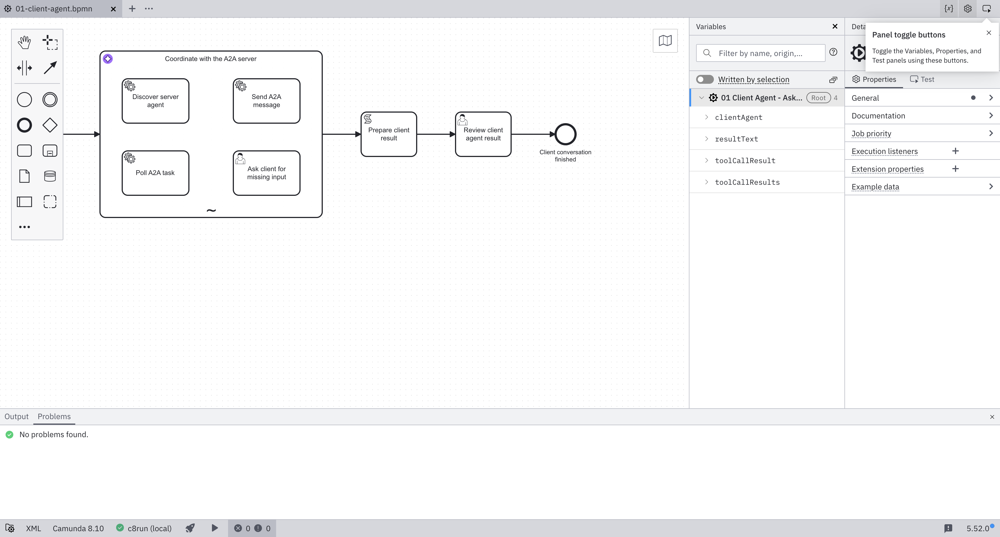
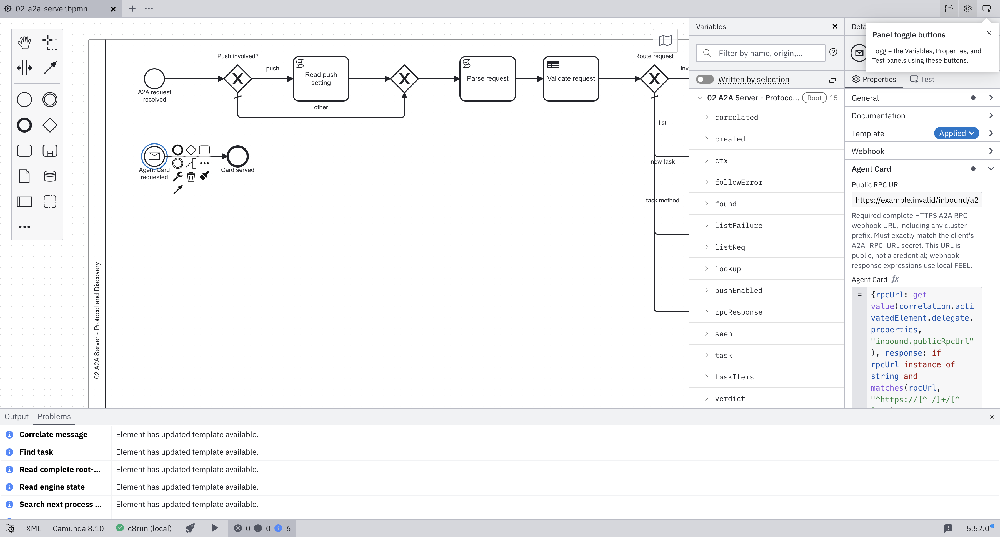

# Native secret references and redacted API-key header

**PASS for the focused checks below** on clean runtime source
`18e2a06652172c000245f489ed7d1c1ecb18c5b3`, compared with main
`58091bffe2a078d3f72b98fdb7c8d6b40b254d18`.
The baseline current blueprint used legacy secret interpolation. Current resources use native
`camunda.secrets` inputs and inbound credential binding without legacy-secret warnings.
Exact secret names remain unchanged; this requires the engine's default secret store, not
Connector-only environment secrets.

## Configuration and caller migration

Whole inputs, FEEL context leaves and URL concatenations use unquoted native references.
Stock webhook response callbacks instead use local FEEL and cannot resolve those references.
The Card template therefore has a required, empty, editable **Public RPC URL** field.
It must exactly match the client's existing `A2A_RPC_URL` secret, including cluster prefix/path.
Missing, empty or HTTP values produce an explicit HTTP 500 setup error; no endpoint default is supplied.
The URL is public discovery data, never a credential.

External callers must change **`X-A2A-Api-Key` to `X-Api-Key`**. The credential remains
`A2A_API_KEY`; the current Card advertises the new header and there is no old-header fallback.
Stock Connectors 8.10.2 logs requests before authentication and masks only its fixed header list,
including `x-api-key`, not the previous custom header. Do not send credentials in the old header.
Historical immutable packages retain their own contract and setup.

The implementation follows pinned engine 8.10.2 input-mapping/store behavior and stock Connectors
8.10.2 commit `b490d065b59ffe4788319609dbe41deb25e68e3f`.
See [native secret setup](../../blueprint/README.md#cluster-secret-store) and the pinned
[webhook controller](https://github.com/camunda/connectors/blob/b490d065b59ffe4788319609dbe41deb25e68e3f/connector-runtime/connector-runtime-spring/src/main/java/io/camunda/connector/runtime/inbound/webhook/InboundWebhookRestController.java).
The custom RPC/Card templates are version 2 with engine constraint `^8.10`; AI and REST template
versions, bounded model calls, history mappings and diagram layout are unchanged.

## Focused authenticated runtime

The [sanitized report](client-agent-e2e.json) records engine/Connectors **8.10.2** and
Elasticsearch **8.19.23**, with a disposable engine default file store.
Seven BPMN/DMN/form resources deployed through the authenticated API.
Direct trusted HTTPS discovery returned the exact configured RPC URL; missing/invalid keys returned 401.
The actual-model client discovered, sent, polled, requested explicit confirmation and followed up on the
same task/context with exactly one confirmed data part. Both processes completed and the reconciliation
artifact matched all nine expected fields.

The verifier scanned untruncated persisted variable values and all available owned engine/Connectors
container logs through client completion for the random engine password, API key and encoded Basic
credential. None appeared. This is a bounded check of those surfaces/values, not a proof about every
internal engine history record, external proxy or future logging configuration. No logging suppression
was added. Raw runtime logs and secret values are not published.

Both agents used the authorized local Ollama override `qwen3-coder-30b-64k:latest`, not a SaaS model.
The eight-model-call and 20-message limits were not relaxed. One run at this same source failed because
the client model returned while the task still required input; the unchanged repeat passed.
This result does not establish deterministic model decisions, SaaS execution, other version pairs,
full A2A conformance, production readiness or Marketplace eligibility.

## Affected checks and actual Modeler

[Validation metadata](validation.json) pins asset hashes and records generation, 17 resource tests,
13 import resources, 18 layout checks, 15 selected Python tests, three form schemas and four official
BPMN XSD validations. Affected Maven suites cover 38 tests, with no failures/errors/skips.
Their HTTP stub uses explicit mock-secret inputs; it is not native resolution evidence.
Native resolution is covered separately by the stock-runtime run above.

All four current BPMNs have zero CLI lint issues. Actual Desktop Modeler **5.52.0**, in isolated
profiles with the pinned templates, has zero errors/warnings and zero legacy-secret warnings.
The Basic profile has six unrelated template-update **INFO** messages, not warnings.
Modeler 5.51.1 misidentifies native references as older deprecated syntax; no rule was suppressed.
The required public URL was edited, HTTP rejected, and an HTTPS value saved through Modeler's native
File menu. Editor copies use `https://example.invalid/inbound/a2a`, not a shipped default/runtime URL.

The historical `verify.py` matrix modes now fail before provisioning on current resources, directing
contributors to `verify_client_agent.py` or a whole pinned historical package. Their default 8.9
environment does not configure the native store/public URL and is not current-package verification.
The preflight is tested; no fresh broad matrix or TCK pass is claimed.
Earlier failed discovery, namespace and credential-log checks are retained as sanitized failure reports
alongside the passing run. Existing historical evidence is untouched.
