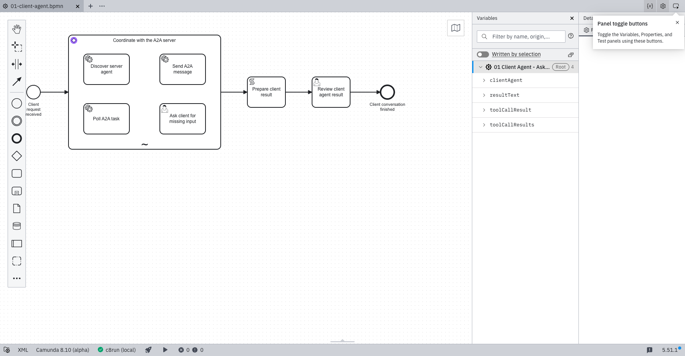

# Compact AI Agent Sub-process client verification

**PASS for the focused checks below** on clean source
`9c4310491609edf8ffcaf66672c4e9f9c1f38237`, compared with main
`565adf7e740aa472cb0cc3f813ca43ff861e73b5`.
The baseline client used an AI Agent Task, a tall external tool container, and explicit
feedback-loop gateways. The candidate uses the actual AI Agent Sub-process connector,
four selectable root tools in a two-by-two grid, and five left-to-right top-level nodes.
The stock connector owns tool activation and feedback, making the diagram smaller
without removing discovery, send, poll, confirmation, or result review.

## Compatibility and response contract

The client uses `io.camunda.connectors.agenticai.ai-agent-subprocess.v2@1`, applied
with `c8ctl element-template apply` from Connectors 8.10.2 commit
`b490d065b59ffe4788319609dbe41deb25e68e3f`. Its engine constraint is `^8.10`.
The complete demo therefore requires engine and Connectors 8.10; there is no fallback client.
REST remains v13 and runtime process IDs and numbering are preserved.

The connector maintains local `agentContext` during tool execution and writes its
final response to `agent`, mapped to `clientAgent` with included conversation context.
The 8.10 context persists tool results as structured content blocks. Client history
readers extract the object block for explicit confirmation, response-derived task/context
identity, and final review. The server remains on Job Worker v5; its evidence reader
accepts both legacy objects and the new structured object block. Native 8.10 engine
expression regressions verify both server shapes and the client mappings without warnings.
This is not a fresh 8.9 runtime check.

## Focused authenticated runtime

The [sanitized runtime report](client-agent-e2e.json) records a fresh run on
Camunda 8.10.2, stock Connectors 8.10.2, and Elasticsearch 8.19.23. The seven
BPMN/DMN/form resources deployed through the authenticated engine API. Discovery
used direct trusted HTTPS; missing and invalid task API keys were rejected.

The actual-model client discovered the card, sent an initial message without a structured
claim, requested the explicit confirmation form, and sent exactly one confirmed data part
on the original task and context. It polled that same task to `TASK_STATE_COMPLETED`,
reviewed the exact nine-field reconciliation artifact, and completed its own process.
The eight-model-call limit and 20-message context window were retained. The owned
disposable stack was removed after the run.

Both agents used an authorized local Ollama override, `qwen3-coder-30b-64k:latest`
(digest recorded in the validation JSON), not a SaaS model. Shipped
`CAMUNDA_PROVIDED_LLM_*` secret references remain unchanged. Other version pairs,
SaaS execution, full A2A conformance, production readiness, and Marketplace eligibility
are not established. Earlier failed attempts are recorded in [validation.json](validation.json);
no model limit or acceptance assertion was relaxed.

## Source and actual Modeler checks

The [validation record](validation.json) records reproducible generation, 14 resource
tests, a 13-resource import closure, 18 automated layout checks, five confirmation
Python tests, three valid form schemas, and official BPMN XSD validation for all four
shipping/profile BPMNs. A clean Maven run passed 38 tests with no failures, errors,
or skips across `CoreProtocolTest`, `CoreListingTest`, and `TemplateShapeTest`.

BPMN lint reports zero errors. The client has eight warnings for retained
`{{secrets.NAME}}` syntax under the 8.10 ruleset; the other three shipping/profile
BPMNs have zero issues. Full Python unit discovery is not claimed passing: unchanged
baseline errors concern the absent `client_versions` module and `int()` parsing of
floating-point DI coordinates in `reliability.timed_echo`.

An isolated Desktop Modeler 5.51.1 instance loaded the exact pinned client and REST
templates and reported zero Modeler problems. The rendered diagram was personally
inspected: four straight top-level flows, balanced root tools, and no observed node
or label crossings. The purple 18-by-18 header icon exactly matches upstream embedded
metadata and survives saving a copy. Modeler's static platform label says 8.10 alpha;
the runtime above used stable 8.10.2 images.

The final import manifest has 11 repository resources and two immutable upstream
AI templates; exact paths are in the validation record. Historical evidence is untouched.
